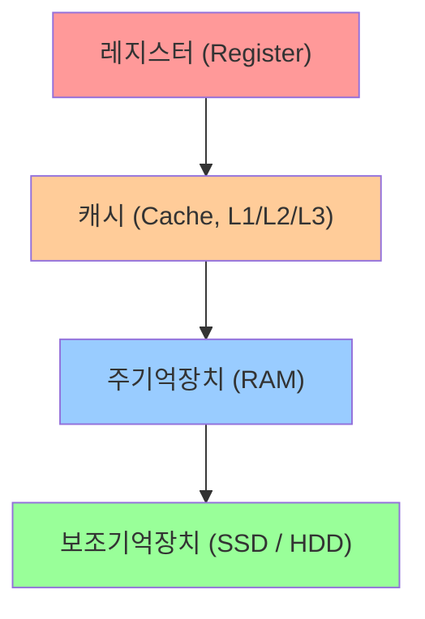

# RAM (Random Access Memory)

작성자: 2022113377 하영모

## 목차

- [개요](#개요)
- [메모리 계층 구조](#메모리-계층-구조)
- [RAM의 종류](#ram의-종류)
  - [SRAM (Static RAM)](#sram-static-ram)
  - [DRAM (Dynamic RAM)](#dram-dynamic-ram)
- [ECC RAM (오류 수정 기능)](#ecc-ram-오류-수정-기능)
- [DDR SDRAM의 세대](#ddr-sdram의-세대)
- [RAM 타이밍 — CAS Latency(CL)](#ram-타이밍--cas-latencycl)
- [선택 가이드](#선택-가이드)
- [용어 정리 (Glossary)](#용어-정리-glossary)

## 개요

RAM(Random Access Memory)은 컴퓨터가 동작하는 동안 프로그램 코드와 데이터를 저장하는 주기억장치입니다. CPU는 레지스터와 캐시에 없는 데이터가 필요할 때 RAM에서 가져오며, 저장된 위치와 상관없이 일정한 시간 안에 어느 주소든 바로 접근할 수 있다는 점이 이름("Random Access")의 유래입니다.

RAM은 전원이 꺼지면 내용이 모두 사라지는 휘발성(volatile) 메모리입니다. 전원이 꺼져도 데이터가 유지되는 SSD/HDD 같은 보조기억장치와는 역할이 다르며, "지금 실행 중인 작업을 빠르게 처리하기 위한 임시 작업 공간"이라고 이해하면 됩니다.


## 메모리 계층 구조

컴퓨터의 메모리는 속도와 용량에 따라 계층 구조를 이룹니다. RAM은 이 계층에서 중간 역할을 담당합니다.



위로 갈수록 속도가 빠르고 용량이 작으며 가격이 비쌉니다. RAM은 GB 단위의 충분한 용량과 수십 ns 수준의 빠른 접근 속도를 갖추어, CPU가 필요로 하는 데이터를 실시간으로 공급하는 역할을 합니다.

## RAM의 종류

### SRAM (Static RAM)

SRAM은 플립플롭(flip-flop) 회로로 데이터를 저장합니다. 전원이 유지되는 한 별도의 리프레시 없이 데이터가 보존되며, 속도가 매우 빠릅니다. 단, 셀 하나에 트랜지스터가 6개 필요해 집적도가 낮고 가격이 비쌉니다. 주로 CPU의 캐시 메모리(L1, L2, L3)에 사용됩니다.

### DRAM (Dynamic RAM)

DRAM은 커패시터(capacitor)에 전하를 충전하여 데이터를 저장합니다. 커패시터는 자연적으로 방전되므로, 일정 주기마다 데이터를 다시 써주는 리프레시(refresh) 동작이 필요합니다. SRAM보다 느리지만 셀 구조가 단순(트랜지스터 1개 + 커패시터 1개)해 집적도가 높고 가격이 저렴합니다. 일반 PC의 메인 메모리로 사용되는 것이 바로 DRAM 계열입니다.

| 구분 | SRAM | DRAM |
|------|------|------|
| 저장 방식 | 플립플롭 | 커패시터 |
| 리프레시 | 불필요 | 필요 |
| 속도 | 빠름 | 상대적으로 느림 |
| 집적도 | 낮음 | 높음 |
| 가격 | 비쌈 | 저렴 |
| 주요 용도 | CPU 캐시 | PC 주기억장치 |

## ECC RAM (오류 수정 기능)

RAM은 우주선(cosmic ray)이나 전자기 노이즈, 전압 불안정 등의 영향으로 아주 드물게 저장된 비트 값이 저절로 뒤집히는 현상이 발생할 수 있습니다. 이를 비트 플립(bit flip) 또는 소프트 에러(soft error)라고 부르며, 일반 가정용 PC에서는 체감하기 어려울 정도로 발생 빈도가 낮지만, 수백~수천 대의 서버가 24시간 쉬지 않고 동작하는 데이터센터 환경에서는 통계적으로 무시할 수 없는 수준의 오류율이 됩니다.

ECC(Error Correcting Code) RAM은 이러한 오류를 하드웨어 수준에서 자동으로 감지하고 수정하는 기능이 추가된 메모리입니다. 일반(Non-ECC) RAM이 데이터를 8비트(1바이트) 단위로 저장하는 반면, ECC RAM은 각 8비트 데이터 블록마다 별도의 패리티(parity) 비트를 추가로 저장합니다. 흔히 사용되는 방식은 해밍 코드(Hamming code) 기반의 SECDED(Single Error Correction, Double Error Detection)로, 1비트 오류는 자동으로 복구하고 2비트 오류는 감지해 시스템에 경고를 보낼 수 있습니다. 이 때문에 ECC 모듈은 일반 DIMM보다 칩이 하나 더 있는 경우가 많고(예: 8개 대비 9개), 용량도 약 12.5% 더 필요합니다.

메모리 컨트롤러가 데이터를 읽을 때마다 저장된 패리티 값과 실제 데이터를 비교해 오류 여부를 판단하기 때문에, 아주 약간의 지연과 비용이 추가로 발생합니다. 이런 특성 때문에 일반 소비자용 PC·노트북·게이밍 PC에는 거의 쓰이지 않고, 서버, 워크스테이션, 금융·의료 데이터 처리 시스템처럼 단 한 번의 데이터 오류도 치명적인 결과(시스템 다운, 데이터 손상, 연산 결과 오염)로 이어질 수 있는 환경에 주로 사용됩니다.

참고로 ECC 기능을 완전히 활용하려면 RAM 모듈뿐 아니라 CPU와 메인보드(칩셋)도 ECC를 지원해야 합니다. 서버용 Xeon/EPYC 계열이나 일부 워크스테이션용 CPU는 ECC를 지원하지만, 일반 소비자용 메인보드는 ECC 모듈을 꽂아도 오류 수정 기능 없이 일반 메모리처럼만 동작하는 경우가 많으므로 구매 전 반드시 호환 여부를 확인해야 합니다.

## DDR SDRAM의 세대

현재 PC에 사용되는 RAM은 대부분 DDR SDRAM(Double Data Rate Synchronous DRAM) 계열입니다. DDR은 클럭의 상승 엣지(rising edge)와 하강 엣지(falling edge) 모두에서 데이터를 전송하여 기존 SDR 대비 2배의 데이터 전송률을 냅니다.

- **DDR4**: 2014년부터 보급된 현재의 표준. 동작 전압 1.2V, 대역폭 최대 25.6GB/s(DDR4-3200 기준).
- **DDR5**: 2021년부터 보급 시작. 동작 전압 1.1V로 낮아졌고, 대역폭이 DDR4 대비 약 2배 향상. 메모리 모듈 내에 전력 관리 회로(PMIC)가 내장되어 더 안정적인 전원 공급이 가능합니다.

DDR4와 DDR5는 물리적 핀 수와 노치 위치가 달라 서로 호환되지 않으므로, 메인보드가 지원하는 규격을 반드시 확인해야 합니다.

## RAM 타이밍 — CAS Latency(CL)

클럭 속도만으로는 RAM의 실제 체감 속도를 다 설명할 수 없습니다. 메모리 컨트롤러가 읽기 명령을 보낸 뒤 실제 데이터가 나오기까지 걸리는 지연을 **CAS Latency(CL)**라고 하며, 단위는 "클럭 사이클 수"입니다. 같은 클럭 속도라면 **CL 숫자가 작을수록** 반응이 빠른 RAM입니다.

제품 스펙에 흔히 보이는 "DDR4-3200 CL16" 같은 표기에서, 실제 지연 시간(ns)은 다음과 같이 계산합니다.

```
실제 지연시간(ns) = CL ÷ 실제 클럭(MHz) × 1000
```

DDR 메모리는 "데이터 전송률(예: 3200)"이 실제 클럭의 2배로 표기되므로, 실제 클럭은 전송률의 절반(1600MHz)입니다. 따라서 DDR4-3200 CL16의 실제 지연시간은 `16 ÷ 1600 × 1000 = 10ns`가 됩니다.

클럭 속도가 높아도 CL이 같이 커지면 실제 지연시간은 거의 비슷해지는 경우가 많기 때문에, 구매 시에는 **전송률과 CL을 함께** 비교하는 것이 정확합니다.

## 선택 가이드

RAM 구매 시 고려해야 할 핵심 항목은 다음과 같습니다.

- **용량**: 일반 사무·웹 브라우징 8GB, 게임·개발 16GB, 영상 편집·고사양 작업 32GB 이상 권장
- **규격(DDR 세대)**: 메인보드가 지원하는 세대(DDR4 / DDR5)와 일치해야 함
- **클럭 속도와 CL**: 클럭은 높을수록 유리하지만 CL도 함께 낮아야 실제 지연시간이 줄어듦 — 위 공식으로 환산해서 비교 권장
- **채널 구성**: 싱글 채널보다 듀얼 채널(같은 용량의 모듈 2개 장착)이 대역폭을 약 2배 높여 성능 향상에 도움이 됨
- **발열**: 고클럭 RAM에는 방열판(히트스프레더)이 달려 있어 안정성을 높이지만, 대형 CPU 쿨러와 간섭이 생길 수 있으므로 케이스 내부 공간 확인 필요

## 용어 정리 (Glossary)

- **휘발성(Volatile)**: 전원이 꺼지면 저장된 데이터가 모두 사라지는 특성. RAM은 휘발성 메모리이고, SSD/HDD는 비휘발성(Non-volatile) 메모리입니다.
- **리프레시(Refresh)**: DRAM의 커패시터가 전하를 잃기 전에 주기적으로 데이터를 다시 써주는 동작. 구조상 커패시터를 쓰지 않는 SRAM에는 필요 없습니다.
- **대역폭(Bandwidth)**: 단위 시간당 전송할 수 있는 데이터 양(보통 GB/s). 클럭 속도와 채널 수에 영향을 받습니다.
- **클럭(Clock)**: 메모리가 데이터를 주고받는 속도의 기준이 되는 신호 주파수. DDR는 클럭의 상승/하강 엣지를 모두 사용해 전송률을 2배로 높입니다.
- **CAS Latency(CL)**: 읽기 명령 후 실제 데이터가 출력되기까지 걸리는 지연 시간(클럭 사이클 수 기준).
- **패리티(Parity)**: 오류 검출·수정을 위해 원본 데이터에 추가로 붙이는 비트. ECC RAM이 이를 이용해 비트 오류를 찾아냅니다.
- **DIMM(Dual In-line Memory Module)**: 메인보드 슬롯에 꽂아 쓰는 일반적인 RAM 모듈의 규격.
- **채널(Channel)**: CPU와 메모리 사이의 데이터 통로 개수. 듀얼 채널은 싱글 채널보다 대역폭이 약 2배 늘어납니다.
- **PMIC(Power Management IC)**: DDR5 모듈 내부에 내장된 전력 관리 회로로, 메인보드 대신 모듈 자체에서 전압을 안정적으로 공급합니다.
