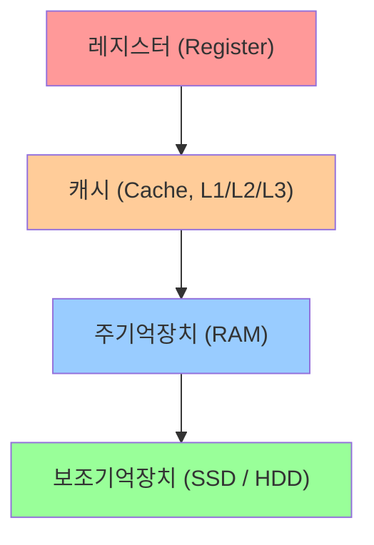

# RAM (Random Access Memory)

작성자: 2022113377 하영모

## 개요

RAM(Random Access Memory)은 컴퓨터가 동작하는 동안 프로그램 코드와 데이터를 저장하는 주기억장치입니다. CPU는 레지스터와 캐시에 없는 데이터가 필요할 때 RAM에서 가져오며, 저장된 위치와 상관없이 일정한 시간 안에 어느 주소든 바로 접근할 수 있다는 점이 이름("Random Access")의 유래입니다.

RAM은 전원이 꺼지면 내용이 모두 사라지는 휘발성(volatile) 메모리입니다. 전원이 꺼져도 데이터가 유지되는 SSD/HDD 같은 보조기억장치와는 역할이 다르며, "지금 실행 중인 작업을 빠르게 처리하기 위한 임시 작업 공간"이라고 이해하면 됩니다.

## 메모리 계층 구조

컴퓨터의 메모리는 속도와 용량에 따라 계층 구조를 이룹니다. RAM은 이 계층에서 중간 역할을 담당합니다.

위로 갈수록 속도가 빠르고 용량이 작으며 가격이 비쌉니다. RAM은 GB 단위의 충분한 용량과 수십 ns 수준의 빠른 접근 속도를 갖추어, CPU가 필요로 하는 데이터를 실시간으로 공급하는 역할을 합니다.

## RAM의 종류

### SRAM (Static RAM)

SRAM은 플립플롭(flip-flop) 회로로 데이터를 저장합니다. 전원이 유지되는 한 별도의 리프레시 없이 데이터가 보존되며, 속도가 매우 빠릅니다. 단, 셀 하나에 트랜지스터가 6개 필요해 집적도가 낮고 가격이 비쌉니다. 주로 CPU의 캐시 메모리(L1, L2, L3)에 사용됩니다.

### DRAM (Dynamic RAM)

DRAM은 커패시터(capacitor)에 전하를 충전하여 데이터를 저장합니다. 커패시터는 자연적으로 방전되므로, 일정 주기마다 데이터를 다시 써주는 리프레시(refresh) 동작이 필요합니다. SRAM보다 느리지만 셀 구조가 단순(트랜지스터 1개 + 커패시터 1개)해 집적도가 높고 가격이 저렴합니다. 일반 PC의 메인 메모리로 사용되는 것이 바로 DRAM 계열입니다.

| 구분 | SRAM | DRAM |
|------|------|------|
| 저장 방식 | 플립플롭 | 커패시터 |
| 리프레시 | 불필요 | 필요 |
| 속도 | 빠름 | 상대적으로 느림 |
| 집적도 | 낮음 | 높음 |
| 가격 | 비쌈 | 저렴 |
| 주요 용도 | CPU 캐시 | PC 주기억장치 |

## DDR SDRAM의 세대

현재 PC에 사용되는 RAM은 대부분 DDR SDRAM(Double Data Rate Synchronous DRAM) 계열입니다. DDR은 클럭의 상승 엣지(rising edge)와 하강 엣지(falling edge) 모두에서 데이터를 전송하여 기존 SDR 대비 2배의 데이터 전송률을 냅니다.

- **DDR4**: 2014년부터 보급된 현재의 표준. 동작 전압 1.2V, 대역폭 최대 25.6GB/s(DDR4-3200 기준).
- **DDR5**: 2021년부터 보급 시작. 동작 전압 1.1V로 낮아졌고, 대역폭이 DDR4 대비 약 2배 향상. 메모리 모듈 내에 전력 관리 회로(PMIC)가 내장되어 더 안정적인 전원 공급이 가능합니다.

DDR4와 DDR5는 물리적 핀 수와 노치 위치가 달라 서로 호환되지 않으므로, 메인보드가 지원하는 규격을 반드시 확인해야 합니다.

## 선택 가이드

RAM 구매 시 고려해야 할 핵심 항목은 다음과 같습니다.

- **용량**: 일반 사무·웹 브라우징 8GB, 게임·개발 16GB, 영상 편집·고사양 작업 32GB 이상 권장
- **규격(DDR 세대)**: 메인보드가 지원하는 세대(DDR4 / DDR5)와 일치해야 함
- **클럭 속도**: 높을수록 데이터 전송이 빠르지만, CPU와 메인보드가 지원하는 최대 속도를 확인
- **채널 구성**: 싱글 채널보다 듀얼 채널(같은 용량의 모듈 2개 장착)이 대역폭을 약 2배 높여 성능 향상에 도움이 됨
- **발열**: 고클럭 RAM에는 방열판(히트스프레더)이 달려 있어 안정성을 높이지만, 대형 CPU 쿨러와 간섭이 생길 수 있으므로 케이스 내부 공간 확인 필요
